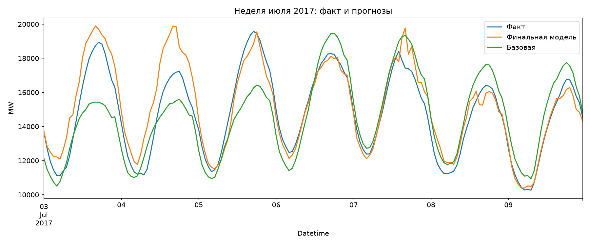
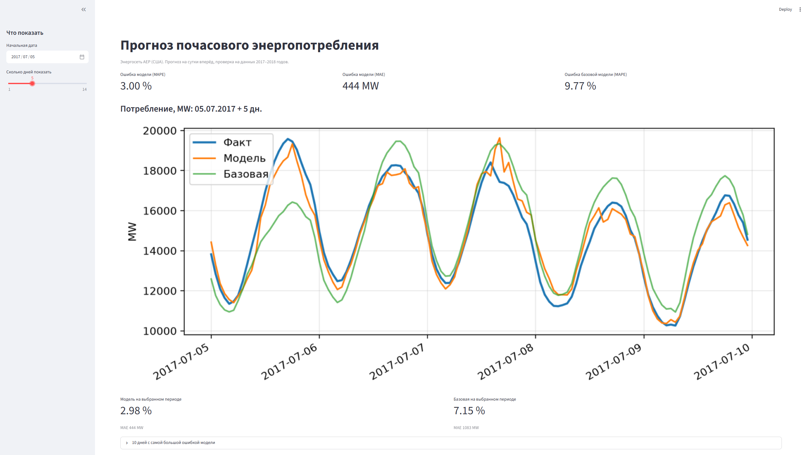

# Прогноз почасового энергопотребления

Модель машинного обучения, которая прогнозирует потребление электроэнергии на сутки вперёд по данным энергосети AEP (США).

## Задача

Энергосистеме нужно заранее знать, сколько электроэнергии потребуется в каждый час следующих суток: от точности прогноза зависит, сколько мощности нужно держать в резерве. Цель проекта: построить такой прогноз и честно оценить его качество на данных, которые модель не видела при обучении.

## Данные

- **Потребление:** [Hourly Energy Consumption](https://www.kaggle.com/datasets/robikscube/hourly-energy-consumption) (Kaggle, данные PJM), файл `AEP_hourly.csv`: почасовые значения в МВт с октября 2004 по август 2018, около 121 тысяч строк.
- **Погода:** почасовая температура с сервиса [Open-Meteo](https://open-meteo.com/) для Колумбуса (штат Огайо) как приближение для всей энергосистемы.

Файл с потреблением в репозиторий не включён: скачайте его с Kaggle и положите в папку `data/`.

## Что сделано

1. **Очистка данных.** В данных были повторяющиеся и пропущенные часы из-за перехода на летнее и зимнее время. Ряд приведён к ровной почасовой сетке, пропуски заполнены линейной интерполяцией.
2. **Анализ закономерностей.** Суточный ритм (минимум около 4 утра, максимум вечером), недельный (по выходным потребление ниже), сезонный (пики зимой и летом).
3. **Признаки.** Час, день недели, потребление в этот же час сутки и неделю назад, температура и её динамика. Для честного прогноза «на сутки вперёд» используются только лаги не меньше 24 часов, чтобы не заглядывать в будущее.
4. **Проверка по времени.** Обучение на данных до конца 2016 года, проверка на 2017–2018 годах (около 13,9 тысячи часов). Случайное перемешивание не использовалось, чтобы не получить завышенную точность.
5. **Модель.** Градиентный бустинг (`HistGradientBoostingRegressor` из scikit-learn).

## Результаты

| Модель | MAE, MW | MAPE |
|---|---|---|
| Базовая: «как неделю назад в этот час» | 1475 | 9,77% |
| Время и история потребления | 724 | 4,86% |
| + признак праздничного дня | 724 | 4,87% |
| + температура | 484 | 3,29% |
| + динамика температуры | 444 | 3,01% |
| **Финальная (8 признаков)** | **444** | **3,01%** |

Ошибка снижена примерно втрое относительно базовой модели. Праздники точность не улучшили (их мало: около 3% часов), поэтому в финальную модель не вошли. Три малозначимых признака (`is_weekend`, `month`, `roll_mean_24`) были убраны: качество при этом не изменилось.



## Дашборд



Интерактивная страница на Streamlit: можно выбрать любую дату из проверочного периода (2017–2018) и посмотреть, как прогноз модели и базовый прогноз соотносятся с реальным потреблением, а также какие дни модель предсказывает хуже всего.

### Что важнее всего для модели

По перестановочной важности признаков (на сколько растёт ошибка, если признак «испортить») с большим отрывом лидирует потребление в тот же час сутки назад (`lag_24`), затем день недели и температурные признаки.

### Разбор ошибок

Самые большие ошибки модели приходятся на зимние дни с сильными холодами: добавление температуры снизило ошибку в этих днях в 2–6 раз. Отдельно разобран день 24 апреля 2018 года: данные и температура в этот день выглядят нормально, но потребление оказалось заметно ниже, чем вчера и неделю назад, и модель завысила прогноз примерно на 2000 МВт. Причину по имеющимся признакам установить не удалось.

## Ограничения

- Использована **фактическая** температура, а в реальном прогнозе на завтра есть только прогноз погоды, который сам неточен. В боевых условиях ошибка была бы выше.
- Погода берётся из одной точки, а энергосистема охватывает несколько штатов.
- Модель не настраивалась по гиперпараметрам, проверка выполнена на одном разбиении по времени.
- Данные американские; перенос на российские данные потребует отдельной работы.

## Как запустить

```
pip install -r requirements.txt
```

Скачайте `AEP_hourly.csv` с Kaggle и положите в папку `data/`. Дальше:

- блокнот с анализом: откройте `analysis.ipynb`;
- дашборд: `streamlit run app.py` (при первом запуске скачивается температура с Open-Meteo и обучается модель, это занимает около минуты).

## Автор

Артём(ta780)


